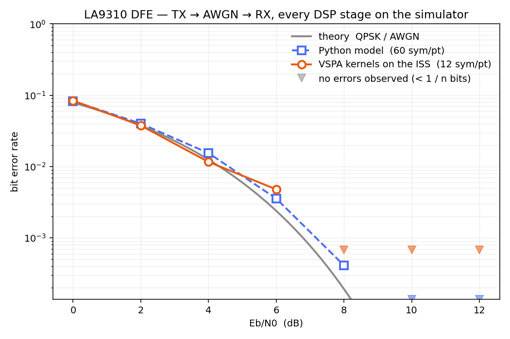

# DFE LA9310

NXP's Digital Front End reference application for the **LA9310** (single-core VSPA2,
16 AU, 1T2R, 25 MHz / 30 kHz) — and a **co-simulation that explains it and proves it
right**, driven by NXP's own 3GPP FR1 test vectors.

No Docker, no Wine, no CodeWarrior, no hardware. The compiler and the VSPA
instruction-set simulator are both native Linux binaries, and the simulator runs
*inside* the Python process.


## The repository has two halves

### `firmware/` — the classical VSPA part

The DFE application as it runs on the chip: C and VSPA assembly, compiled by
`fsvspacc`, linked against NXP's `lib_DFE_Ref_vspa2.elb`, producing one ELF that a
real LA9310 would boot.

```
make            ->  firmware/eld/dfe-la9310-1t2r-25m30k.eld
```

This half is NXP's, and is edited as little as possible.

### `cosim/` — the simulation

A **co-simulation**: the real firmware executes on the VSPA ISS while a
**bit-accurate Python model** of the same DSP runs alongside it, and the two are
compared sample for sample.

The Python model is not a convenience re-implementation in floating point. It
reproduces the VSPA's arithmetic exactly — SM16 sign-magnitude, the AU's rounding
modes, the DIF FFT's bit-reversed output order — so "the firmware and the model
agree" is a **correctness proof**, not a smoke test.

```
                    ┌─────────────────────────────┐
   NXP FR1          │  firmware.eld  on the ISS   │
   test vector ────>│  (the real iFFT/FFT/filters)│────> samples
        │           └─────────────────────────────┘         │
        │                                                   ├── compare
        │           ┌─────────────────────────────┐         │   bit for bit
        └──────────>│  cosim/vspa_model  (Python) │────> samples
                    │  bit-accurate, not float    │
                    └─────────────────────────────┘
```

Its second job is **pedagogical**: to take the DFE reference app apart into its
building blocks — subcarrier mapping, the 1024-point iFFT, bit-reversal, windowing,
the 2× rate converters, the receive chain — and let you push arrays through **one
stage at a time** and see what each one does. Each stage is built as its own ELF
under `cosim/kernels/`, linking the *same* library the firmware links, so you are
stepping through the real DSP rather than a copy of it.

Start with **[`docs/TUTORIAL.md`](docs/TUTORIAL.md)** — a walkthrough with plots.

## Layout

```
firmware/    src/ include/ lcf/ lib/ prebuilt/   the VSPA application
cosim/
  native/    the VSPA ISS, driven in-process via ctypes — no server, no Wine
  dfe/       drives the firmware: boot handshake, mode config, symbol injection
  vspa_model/  the bit-accurate Python model of the VSPA — the independent oracle
  kernels/   one ELF per DSP stage, for stepping through the chain
  scripts/   the verification tiers, the BER co-sim, the figures
  tests/     unit tests
  tools/     the silicon anchor (MD5s captured from a real LA9310)
docs/        TESTING.md (the tiers) · TUTORIAL.md (the walkthrough)
```

## Setup

Nothing below is vendored. The `vspa-sdk` headers and the `bitRev` IPPU kernel come
from NXP's public [`la931x_vspa_common`](https://github.com/nxp-qoriq/la931x_vspa_common)
repo as a git submodule; the toolchain and simulator are public NXP downloads.

```bash
git clone --recurse-submodules <this repo>
cd dfe-la9310
./setup.sh          # submodule + VSPA toolchain + native simulator
```

| what | where from | why |
|---|---|---|
| `submodules/la931x_vspa_common` | [github.com/nxp-qoriq/la931x_vspa_common](https://github.com/nxp-qoriq/la931x_vspa_common) | `vspa-sdk` headers to build the firmware; the `bitRev` IPPU kernel |
| VSPA toolchain `vbeta_14_00_781` | `nxp.com/lgfiles/sdk/la1224/imx-la9310-sdk-10/` | `fsvspacc` — the compiler |
| native simulator `ccssim2` | `nxp.com/lgfiles/sdk/la1224/imx-la9310-sdk-10/` | `libvspa2_16au.so` — the VSPA ISS (x86_64) |

Already have them? Point at them and skip `setup.sh`:

```bash
export VSPA_TOOLS=/path/to/cwvspa.vbeta_14_00_781_vspa.linux/VSPA_Tools
export VSPA_MODEL=/path/to/ccssim2/bin/libvspa2_16au.so
```

Cloned without `--recurse-submodules`? `git submodule update --init --recursive`.
No license file is needed for this toolchain.

## Build and test

```bash
./cosim/scripts/fetch_fr1fr2.sh   # NXP's FR1 vectors + their reference images
make                              # the firmware
make verify                       # tiers 1-5: vectors, IPPU, differential A/B, absolute
make verify-full                  # + tiers 6-9: RX, downstream TX, silicon anchor, kernels
make cosim                        # BER vs SNR: TX -> AWGN -> RX, every stage on the ISS
```

## Status — read this before trusting a green run

**Read [`docs/TESTING.md`](docs/TESTING.md).** The short version:

| tier | what it proves | status |
|---|---|---|
| 1. vectors | the stimulus is parsed correctly | ✅ |
| 2. IPPU | the bit-reverse engine executes (bitRev64 bit-exact) | ✅ |
| 3. differential A/B | this build ≡ NXP's reference build, 18 vector/config cases | ✅ 55296/55296 bit-exact |
| 4. negative control | the A/B can actually *detect* a difference | ✅ |
| 5. **absolute** | the DFE computes the **right** waveform | ✅ **guard-band 60 dB, bit-exact vs the model** |
| 6-7. RX + downstream TX | the rest of the chain is right | ✅ bit-exact |
| 8. **silicon anchor** | the output matches MD5s captured from a **real LA9310** | ✅ |
| 9. link-level | the radio actually carries bits | ✅ BER tracks theory |

Tier 5 is the one that matters, and it passes: the DFE's TX chain is **bit-exact**
against an independent model of the same kernels, on NXP's own vectors. Tier 8 then
anchors the whole thing to hardware that exists.

Getting there needed three conversions that nothing warns you about — **SM16**
(assembly kernels are sign-magnitude, not two's complement), the DIF iFFT's
**bit-reversed** output order, and the symbol **size** in `buf_stat` — plus teaching
the simulator that the **IPPU has its own memory array**. All of it is in
`docs/TESTING.md`.

Keep the absolute tier. A green differential test on a broken chain is still green —
this project proved that the hard way.

## Does the radio actually carry bits?

Bit-exactness is not the same question as *does the link work*. `make cosim` puts the
DFE's transmit and receive chains in a loop with an AWGN channel between them and
measures the **bit error rate** against the textbook QPSK curve, with every DSP stage
running as a real kernel on the simulator.



Each stage is gated against the Python model first (`cosim/scripts/kernel_check.py`):
`dfe_rx`, `x2_interp` and `decim_2x_8tap` are **bit-exact**; `dfe_tx` is 65.6 dB, all
of it the hardware's rounding of the raised-cosine window. *A BER curve built on
unverified stages is a drawing, not a measurement* — and gating them is what exposed
the 64-sample block constraint described in
[`cosim/kernels/README.md`](cosim/kernels/README.md).
