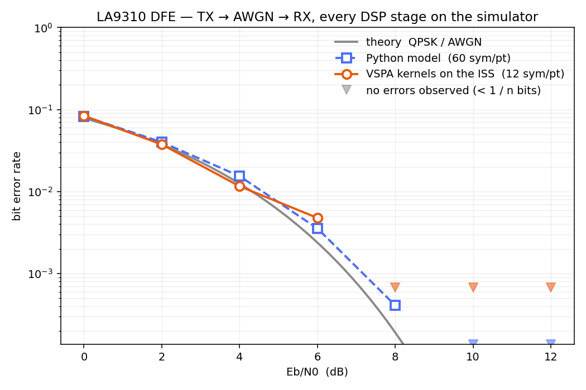

# Testing methodology

How to test a DSP firmware you did not write, against a reference you cannot run,
on a simulator that lies to you if you ask it the wrong question.

## The principle

**A test is only worth what it can detect.** Every tier below states what it
proves *and what it cannot*. The tiers are ordered so that each one closes a hole
the previous one leaves open.

---

## Tier 1 — the stimulus is real

`cosim/tests/test_fr1fr2_vectors.py`

The vectors come from NXP's own [`fr1_fr2_test_tool`](https://github.com/nxp-qoriq/fr1_fr2_test_tool)
— the host-side companion of this very firmware. They are 3GPP NR test models
(`NR-FR1-TM*`, `G-FR1-A1-*`): interleaved little-endian `int16` I/Q, Q15-scaled,
symbol-major, one radio frame. That is already the DMEM wire format, so injection
is a byte copy.

Checked: symbol geometry against the 3GPP frame structure, the byte round-trip,
and that the used subcarriers carry energy while the guard band does not.

**Proves:** we are feeding the firmware what we think we are feeding it.
**Does not prove:** anything about the firmware.

## Tier 2 — the machine executes

`cosim/tests/test_ippu_native.py`

The VSPA has two engines: the VCPU and the **IPPU**, which performs the FFT
bit-reversal. A harness where the IPPU silently does not run will still produce
*plausible-looking, deterministic* numbers — and they will be garbage.

`bitRev64` is real IPPU microcode with a golden reference, so it fails loudly.

**Proves:** the IPPU executes correctly (64/64 bit-exact, zero IPPU errors).
**Does not prove:** that the DFE uses it correctly.

> **The bug this tier was built to catch.** The IPPU has its **own memory array**
> (`VSPA::ippuDmem`, a `MemArray` named `"rudmem"`), physically separate from the
> VCPU's. The debug write path has **no partition redirect** — `wmem` with space 1
> calls `VSPA::dmemWrite` unconditionally. So IPPU data loaded into space 1 can
> **never reach the IPPU**. Its tables stayed uninitialised and it read a garbage
> loop count out of them (`ASA loop count must be 255 >= lcnt >= 0, not: 153056`
> — that number is uninitialised memory, not a decode bug).
>
> Fix: route `ippu_dram` to **memory space 3**. Also: do **not** set `go[1]` — the
> IPPU is not a scheduler core, it is stepped from `VSPA::ruby` inside the VCPU's
> `sim_cycle`.

## Tier 3 — differential: this build ≡ the reference build

`cosim/scripts/dfe_ab_compare.py`

NXP's `fr1_fr2_test_tool` ships **prebuilt LA9310 DFE images** (`geul-vspa0.eld`).
So we can push the same symbols through *their* binary and *ours* and compare
sample-for-sample — bit-exact count, EVM in dB, first differing sample.

Current result: **byte-identical** (4096/4096 and 8192/8192 samples, an FDD and a
TDD vector, max error 0 LSB).

**Proves:** the strip-down did not change behaviour on the exercised path.
**Does not prove:** that the behaviour is *correct*. Two builds can agree on a
shared bug — or, as happened here, on garbage.

## Tier 4 — the negative control

`cosim/tests/test_dfe_ab.py`

A comparison that reports IDENTICAL because both sides produce nothing is worse
than no test. So: feed the two builds **different** symbols and require the
harness to *notice*.

Result: different symbols → **1/1024** matching samples (EVM ≈ 0.8 dB,
uncorrelated). The comparison measures real signal.

**Proves:** tier 3's green is not a false positive.
**Does not prove:** correctness. Run this whenever a tier-3 result surprises you.

## Tier 5 — absolute: is the output *right*?

`cosim/scripts/dfe_absolute_check.py` — **GREEN.**

Tiers 3 and 4 are self-referential: they compare the firmware to another
firmware. Tier 5 asks the independent question, two ways that share no code with
the DFE:

1. **Structural.** A real OFDM time-domain symbol, transformed back to frequency,
   must show the 624 occupied subcarriers and ~400 **near-empty guard bins**.
   Threshold ≥ 20 dB. **Measured: ~60 dB.**
2. **Model.** Compare against `cosim/vspa_model`'s `r_dif_fft_sc128` — a Python
   model of the very kernel the firmware calls — fed through the same subcarrier
   packing. Threshold ≥ 40 dB SNR. **Measured: BIT-EXACT (SNR = ∞).**

So the DFE's TX chain is **verified correct**, not merely unchanged.

**This tier earned its keep twice.** An early version of this harness reported the
two builds "100 % bit-exact" — and it was *true*. The bytes were also **not an
OFDM waveform at all** (0.1 dB guard-band suppression). The IPPU wasn't running;
tiers 3 and 4 were both green and both useless. **Only the absolute check could
see it.**

### The three conversions that decide everything

Each one silently corrupts the result if you skip it, and none of them announce
themselves:

1. **SM16.** VSPA **assembly** kernels use **sign-magnitude 16** (sign in bit 15,
   magnitude in 14:0), *not* two's complement. The DFE's iFFT is an assembly
   kernel: its input must be SM16 and its output **is** SM16. NXP's FR1 vectors
   are two's-complement Q15, so convert on the way in.

   The failure mode is worth memorising, because it nearly looks like a hardware
   bug: SM16 `−64` is `0x8040`, which read as two's complement is `−32704`. A real
   OFDM symbol is about half negative, so the output looks like **saturated
   noise** — while a **DC-only** symbol (the single case with no negative samples)
   comes out **exactly right**. Every non-DC subcarrier was garbage and DC alone
   was perfect. That asymmetry is what finally named the bug; the measured
   fingerprint was a mean |x| of exactly **16384.00 = (32704 + 64)/2**.

2. **Bit-reversal.** The DIF iFFT emits bins in **bit-reversed** order. Undo it.
   (On hardware the IPPU does this; that is what `_start_ippu_bitrev_tx` is for.)

3. **`buf_stat` carries the symbol SIZE** in bits 16:0. A size of **zero** makes
   the firmware advance its counters while processing **nothing** — it looks like
   it ran.

### And the simulator had to be told about the IPPU

The IPPU has its **own memory array** (`VSPA::ippuDmem`, a `MemArray` named
`"rudmem"`). The debug write path has **no partition redirect** — `wmem` with
space 1 calls `VSPA::dmemWrite` unconditionally — so IPPU data loaded into space
1 can **never reach the IPPU**. Two things fix it:

* route `ippu_dram` to **memory space 3**; and
* set the **DMEM partition**, which is unforgiving:

```python
generic6(0, 0, b"set dmem_partition 128 4924")   # AFTER create_device, BEFORE load_elf
```

`generic6`'s 2nd arg is **`2 × coreIdx`, not the devtype** (with 157 the model
computes `157>>1 = 78 >= nrVspaCores` and **silently drops the string**), it is the
**only** callback that reaches the command parser, the **one-arg** form is
clobbered every cycle by `sim_cycle`, and the `*_dmem_size` commands truncate total
DMEM to 32 KB. Do **not** set `go[1]` — the IPPU is stepped from `VSPA::ruby`
inside the VCPU's `sim_cycle`.


---

## Tier 6 — the RX chain  (`cosim/scripts/dfe_rx_probe.py`)

RX is driven like TX: fake the producer and poke DMEM. Push `[CP][1024 samples]` (SM16,
**natural** time order) into `_FFTin`, bump `rx_circ_total_produced_size`, and wait for
`num_rx_sym_to_hiphy` to increment. Never let `produced - released` exceed 3840 bytes --
above that `get_valid_size_for_fft_in()` returns 0 and the pipeline stalls silently.

* tone at bin *k* -> peak at the predicted subcarrier, **90-270 dB** sidelobe suppression
* against `r_dif_fft_sc128(inv_flag=0)`: **bit-exact, 1560/1560**
* TX->RX **round trip**: 50.0 dB, scale 0.0620 (theory 1/16 = 0.0625)
* NXP's prebuilt image is bit-exact too -> **the strip-down did not touch RX**

Note the asymmetry, established empirically rather than assumed: the **RX FFT wants
natural time order**. The IPPU reverses the *output* on RX, not the input.

## Tier 7 — the downstream TX stages  (`cosim/scripts/dfe_tx_downstream_probe.py`)

* **CFR and DPD are not in this binary at all** — `DEFAULT_CFR_DISABLE=1`,
  `DEFAULT_DPD_DISABLE=1`, plus an `#error` guard. There is nothing to reach.
* **CP insertion** — bit-exact (the last 80 samples appear at the front). The **IPPU**
  performs it, via `sample_offset`. It only runs when `buf_stat` carries a size
  **greater than `POINTS_FFT*4`**; `process_symbol` writes exactly `4096`, so **no CP is
  inserted by default**.
* **TX windowing** — a monotone 0->1 rise across 16 samples.
* **2x upsampler** — 74.2 dB image rejection; 67 dB SNR against the model.
* The real gate is not `tx_allowed` (compiled out for LA9310) but the **AXIQ DMA retire**
  handshake — solved with a host-side drain, the exact analogue of faking the fetch-DMA.

## Tier 8 — the silicon anchor  (`cosim/tools/dfe_md5_anchor/`)

Your model and your firmware can share a wrong assumption; a chip cannot. NXP's tool
ships MD5s of dumps captured from **real LA9310 hardware**. Three are reproduced
**byte-exactly** (4,915,200-byte files):

| dump | md5 |
|---|---|
| FDD single tone 15 kHz, 25 %, 61 Msps | `bccbdab7f62763014a6d2026ee99ef44` |
| FDD single tone 30 kHz, 25 %, 61 Msps | `3186a4b1fcc7cc4375f90a788fb71b48` |
| FDD single tone 30 kHz + 10 MHz, 25 % | `3ab0d88793f8dec448f873138ac0b536` |

Every parameter was derived from the shell scripts and the firmware source; each matched
on the first run. **No idealised Python NCO reproduces the bytes** — only executing the
real `single_tone_asm` on the ISS does. This validates the ISS's fixed-point arithmetic,
the SM16 encoding and the DMA semantics **against silicon**.

It also settles SM16 from the hardware side: `DMAC_WRC` is documented as "write to AXI
and convert to two's complement", and its mirror `DMAC_RDC` converts *to* sign-magnitude.
The DMEM antenna buffer really is sign-magnitude — `to_sm16()` is what the DMA does, not
a workaround.

---

## The `NSC <= 2N/3` constraint

The subcarrier pack is an **in-place circular copy** (`DFE_func_tx.c:554`):

```c
memcpy_dst_circ(&src[POINTS_FFT - nsc/2], src, nsc*4, src, POINTS_FFT*4);
```

The destination starts at bin `N - nsc/2` while the source still occupies `[0, nsc)`.
They overlap the moment **`nsc > 2N/3`** (= 682 for N = 1024), and the copy then destroys
`1.5*nsc - N` subcarriers *before they are read*. Measured: **682 -> bit-exact, 684 ->
24 dB, 780 -> 4 dB.**

It never fires on silicon: the host caps LA9310 at `nrb=51` -> **612 subcarriers**
(`check_dfe_cap_core_map.sh:528`). `780` is only the firmware's fallback when the host
leaves NSC at zero. **`DfeSession` refuses `nsc > 682`** rather than return a corrupt
symbol.

Coverage note: every earlier test config (288 / 612 / 624) sat below the threshold. The
constraint only surfaced when the A/B was widened to the build's *own* native config.

---

## Tier 9 — does the radio carry bits?  (`cosim/scripts/dfe_cosim.py`)

Tiers 1–8 all ask the same kind of question: *is this output bit-correct?* Tier 9
asks a different one, and it is the question a radio engineer actually cares about:
**does the link work?**

The DFE's transmit and receive chains are put in a loop with a channel between
them, and the bit error rate is measured against the textbook QPSK curve:

```
  TX (VSPA) -> +CP -> 2x interpolate (VSPA) -> AWGN -> 2x decimate (VSPA) -> -CP -> RX (VSPA)
```

Every DSP stage is the real kernel on the simulator — linked from
`firmware/lib/lib_DFE_Ref_vspa2.elb`, the same library the firmware links. Only the channel
is Python. Measured (12 symbols/point):

| Eb/N0 | VSPA | Python model | theory |
|---|---|---|---|
| 0 dB | 8.3e-2 | 8.4e-2 | 7.9e-2 |
| 2 dB | 3.7e-2 | 4.2e-2 | 3.8e-2 |
| 4 dB | 1.2e-2 | 1.7e-2 | 1.3e-2 |
| 6 dB | 4.6e-3 | 3.9e-3 | 2.4e-3 |
| 8 dB | no errors | 3.1e-4 | 1.9e-4 |



Before any of that is believed, `cosim/scripts/kernel_check.py` gates every stage against
an independent Python model: **`dfe_rx`, `x2_interp` and `decim_2x_8tap` are
bit-exact; `dfe_tx` is 65.6 dB**, and its entire residual is 27 samples inside the
32 windowed edges — the hardware's `__fx16 × float` rounding in the raised cosine,
nothing else. *A BER curve built on unverified stages is a drawing, not a
measurement.*

### What this tier caught

**The rate converters process whole 64-sample blocks.** `X2_interp_tap32_filter`'s
header says so plainly, and the kernel does not complain when you violate it — it
processes the whole blocks and leaves the tail as garbage.

The original co-simulation used a 20-sample cyclic prefix, so it handed the
interpolator 1024 + 20 = **1044** samples. `1044 = 16*64 + 20`. Measured: outputs
0–2047 bit-exact, outputs **2048–2087 garbage** — and those samples land in the
cyclic prefix, the region the receiver slices to absorb filter delay. The BER curve
still looked plausible.

The prefix is now **64 samples** (1024 + 64 = 1088 = 17×64), and every stage is
bit-exact. It is the same lesson as tier 5, in a new place: *the chain agreed with
itself while one link in it was quietly broken.*

## Rules of thumb

* **Read-back is not an oracle.** The simulator's `rmem`/`wmem` byte-reverse
  *within the access size*, so what you write is what you read even when the core
  sees something else entirely. Comparing your read-back against a reference
  implementation's write arguments is meaningless — both pass through the
  transform. The only oracle is **whether a kernel computes the right answer**.
* **An elementwise kernel cannot validate a memory layout.** `vec_add` stayed
  256/256 bit-exact under a byte order that swapped adjacent samples, because
  swapping both operands swaps the result back. Validate layout with something
  that **mixes lanes** — an FFT.
* **A green differential test on a dead engine is still green.** Always keep an
  absolute tier, even if it is red.
* **Coverage is part of correctness.** A test that only runs where it passes proves
  nothing. Widening the A/B to the build's own native config immediately exposed a real
  firmware constraint (`nsc <= 2N/3`) that every previous config had accidentally dodged.
* **Anchor to the chip, not to your model.** Your model and your firmware can share the
  same wrong assumption. Matching one MD5 of a real silicon dump is worth more than any
  amount of self-consistency.
