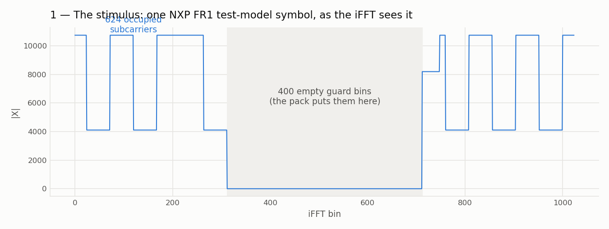
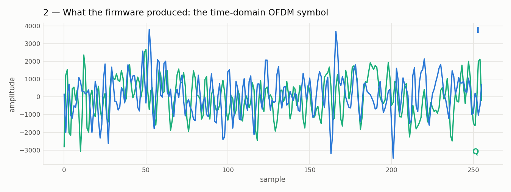
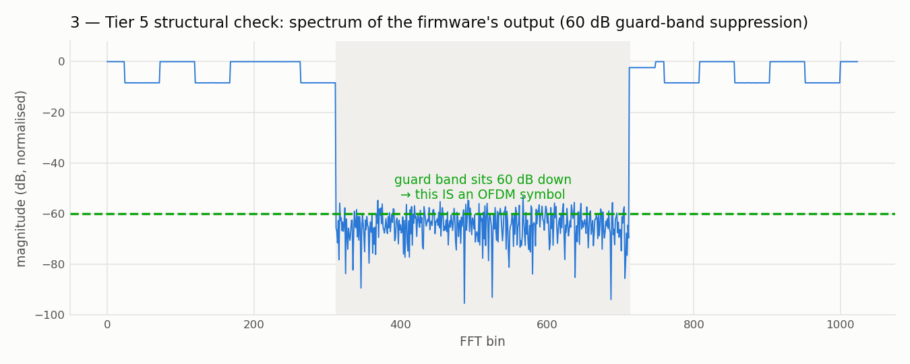
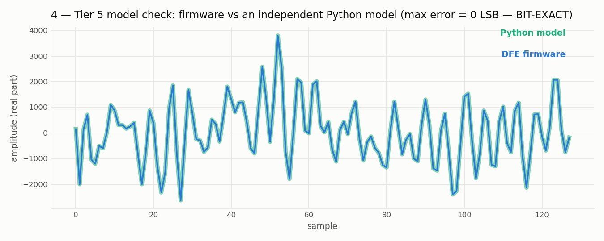
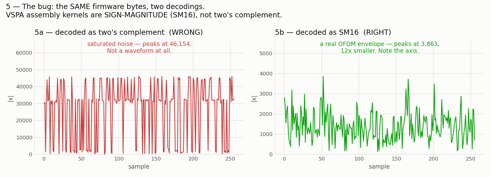
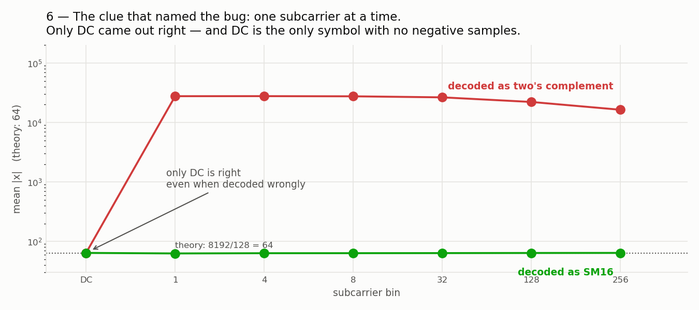

# Tutorial — driving the LA9310 DFE in simulation

**What you'll learn:** how the LA9310 DFE's transmit chain works, how to push a 3GPP test
vector through the real firmware on a simulator, and how to prove the waveform that comes
out is *correct*.

No Docker, no Wine, no CodeWarrior, no hardware — the VSPA instruction-set simulator runs
in-process, driven from Python.

Every figure below is produced by a live simulator run (`cosim/scripts/make_tutorial_figures.py`).

---

## Setup

```bash
export VSPA_TOOLS=/path/to/cwvspa.../VSPA_Tools          # fsvspacc, to build the firmware
export VSPA_MODEL=/path/to/ccssim2/bin/libvspa2_16au.so  # the ISS itself
./cosim/scripts/fetch_fr1fr2.sh      # NXP's FR1 test vectors + their prebuilt reference images
make                           # -> firmware/eld/dfe-la9310-1t2r-25m30k.eld
```

---

## 1. The transmit chain

The DFE turns a grid of frequency-domain subcarriers into a time-domain OFDM symbol:

```
  624 subcarriers                                          1024 time samples
        |                                                          ^
        v                                                          |
   phase comp  ->  subcarrier pack  ->  iFFT-1024  ->  IPPU bit-reverse  ->  CP + windowing
                   (into DFT bins)      (DIF)          (reorders bins)       (-> antenna)
```

Two engines do the work. The **VCPU** runs the C and the vector kernels; the **IPPU** is a
separate co-engine that performs the FFT's bit-reversal and the cyclic-prefix insertion.
They matter to you because they have **separate memories** — see §6.

## 2. The stimulus

The vectors come from [`nxp-qoriq/fr1_fr2_test_tool`](https://github.com/nxp-qoriq/fr1_fr2_test_tool),
the host-side companion of this firmware: 3GPP NR test models stored as interleaved
little-endian `int16` I/Q, Q15-scaled. That is already the DMEM wire format, so injecting a
symbol is a byte copy.

```python
from fr1fr2_vectors import load_fd_grid
grid = load_fd_grid("nxp/fr1_fr2_test_tool/test_vectors/TM3.3_10MHz_15kHz_FDD.bin",
                    scs=15, bw=10)          # 140 symbols x 640 stored / 624 used REs
sym  = grid.symbol_bytes(0)
```

The firmware maps those 624 subcarriers onto a 1024-point iFFT grid, leaving **400 empty
guard bins** in the middle. Remember that guard band — it is what makes the output
verifiable later.



## 3. Run the firmware

```python
from dfe.session import DfeSession
d   = DfeSession("firmware/eld/dfe-la9310-1t2r-25m30k.eld", nsc=624)
out = d.process_symbol(sym)      # -> 1024 complex time-domain samples
```

`DfeSession` boots the real DFE image, completes its mailbox handshake, configures the
LA9310 control block, and hands the firmware a symbol. Everything after that is the
firmware's own code, running as it would on silicon.



That *looks* like an OFDM symbol. Looking like one is not evidence — so let's prove it.

---

## 4. Proving it: two independent checks

### Structural — is it an OFDM symbol at all?

Transform the output back to the frequency domain. A real OFDM symbol **must** show its
occupied subcarriers and a near-empty guard band. This check needs no reference
implementation: the signal either has this shape or it isn't OFDM.



The guard band sits **60 dB down**. It is an OFDM symbol.

### Model — is it the *right* OFDM symbol?

Structure is not correctness. Compare against an **independent Python model** of the same
kernels (`cosim/vspa_model`), which shares no code with the firmware:

```bash
python3 cosim/scripts/dfe_absolute_check.py --eld firmware/eld/dfe-la9310-1t2r-25m30k.eld
```

```
guard-band suppression :   60.05 dB  [PASS, need >= 20.0]
SNR vs Python model    :      inf dB  [PASS, need >= 40.0]
ABSOLUTE CHECK PASSED — the firmware computes a correct OFDM symbol
```

`SNR = inf` means **bit-exact** — not one sample differs.



---

## 5. The four things you must get right

These are properties of the VSPA and of this firmware. Get any one of them wrong and you
will get plausible-looking numbers that are entirely false. `DfeSession` already handles all
four; you need to know them if you extend it.

### SM16 — sign-magnitude, not two's complement

**VSPA *assembly* kernels use sign-magnitude 16**: sign in bit 15, magnitude in bits 14:0.
Two's complement is what nearly every other DSP uses — and what NXP's own vectors are stored
in — so convert on the way **in** and decode on the way **out**.

The hardware says the same thing from the other side: the DMA descriptor `DMAC_WRC` is
documented as *"write to AXI and convert to two's complement"*, and its mirror `DMAC_RDC`
converts *to* sign-magnitude. The DMEM buffers really are sign-magnitude.

Read an SM16 buffer as two's complement and every **negative** sample becomes a large
positive one — `-64` (`0x8040`) reads as `-32704`:



Same bytes. One decoding is a waveform; the other is saturated noise.

A diagnostic worth knowing: push a **single subcarrier** through the chain. The correct
answer is a constant magnitude of `8192/128 = 64` for *every* bin. If only **DC** comes out
right, your decoder is mangling negatives — DC is the one symbol with no negative samples.



### Bit-reversal — the DIF iFFT emits bins out of order

The iFFT is decimation-in-frequency, so its output lands in **bit-reversed** bin order. On
silicon the **IPPU** undoes this (that is what `start_ippu_bitrev_tx` is for). If you read
the iFFT's buffer directly, un-reverse it yourself.

Note the asymmetry on receive: the **RX FFT wants natural time order** — there the IPPU
reverses the *output*, not the input.

### `buf_stat` carries the symbol size

The size lives in bits 16:0 of `buf_stat`. A size of **zero** makes the firmware advance its
counters while processing **nothing** — indistinguishable from a successful run unless you
check the data.

The size also controls CP insertion: the cyclic prefix is only added when the size exceeds
`POINTS_FFT * 4`. `process_symbol` writes exactly `4096`, so **no CP is inserted by
default**.

### `NSC <= 2N/3` — a hard limit on the subcarrier count

The subcarrier pack is an **in-place circular copy** (`DFE_func_tx.c:554`):

```c
memcpy_dst_circ(&src[POINTS_FFT - nsc/2], src, nsc*4, src, POINTS_FFT*4);
```

The destination begins at bin `N - nsc/2` while the source still occupies `[0, nsc)`. They
overlap as soon as **`nsc > 2N/3`** (= **682** for N = 1024), and the copy then destroys
`1.5*nsc - N` subcarriers *before they are read*. Measured: 682 -> bit-exact, 684 -> 24 dB,
780 -> 4 dB.

This never fires on real hardware, because the host caps LA9310 at `nrb=51` -> **612
subcarriers**. `DfeSession` refuses `nsc > 682` rather than hand you a corrupt symbol.

---

## 6. The simulator has two memories

The IPPU has its **own DMEM array**, separate from the VCPU's, and a host write to the VCPU
space can never reach it. Two things are therefore required — both already done for you in
`NativeModel`:

```python
generic6(0, 0, b"set dmem_partition 128 4924")   # AFTER create_device, BEFORE load_elf
```

* `generic6` is the **only** callback that reaches the model's command parser, and its
  second argument is `2 x coreIdx` — **not** the device type. Pass `0`; pass `157` and the
  model silently drops the command.
* Use the **two-argument** form. The one-argument form is recomputed away by `sim_cycle` on
  the next cycle.
* IPPU *microcode* loads to memory **space 2**; IPPU *data* to **space 3**.
* Do **not** try to step the IPPU with `go[1]` — it is driven internally from the VCPU's
  cycle.

---

## 7. What else the harness can do

| | |
|---|---|
| `cosim/scripts/dfe_ab_matrix.py` | compare your build against NXP's prebuilt image across many vectors, bandwidths and full slots |
| `cosim/scripts/dfe_rx_probe.py` | the **RX** chain: tone -> subcarrier, and a TX->RX round trip |
| `cosim/scripts/dfe_tx_downstream_probe.py` | CP insertion, TX windowing, the 2x upsampler |
| `cosim/tools/dfe_md5_anchor/` | reproduce NXP's **real-silicon** dump checksums byte-for-byte |

That last one is the strongest check available. NXP ships MD5s of dumps captured from an
actual LA9310, and three of them are reproduced **byte-exactly** by running the real firmware
kernels on the ISS. Your model and your firmware can share a wrong assumption; a chip cannot.

## 8. How to test a DSP you did not write

The method, in one line: **a test is only worth what it can detect.**

Comparing your build against a reference build proves only that the two **agree** — never
that either is **right**. Two builds can produce identical garbage and report 100 % bit-exact.
So always keep an *absolute* tier that asks an independent question: does the signal have the
structure it must have (that guard band), and does it match a model that shares no code with
the firmware?

And run it **everywhere**, not just where it passes. Widening this harness to the build's own
native configuration is what surfaced the `nsc <= 2N/3` limit above — a real constraint that
every narrower test had stepped around by luck.

Full methodology, tier by tier, including what each one *cannot* prove:
**[`TESTING.md`](TESTING.md)**.

## Reproduce the figures

```bash
python3 cosim/scripts/make_tutorial_figures.py     # each one from a live simulator run
```
