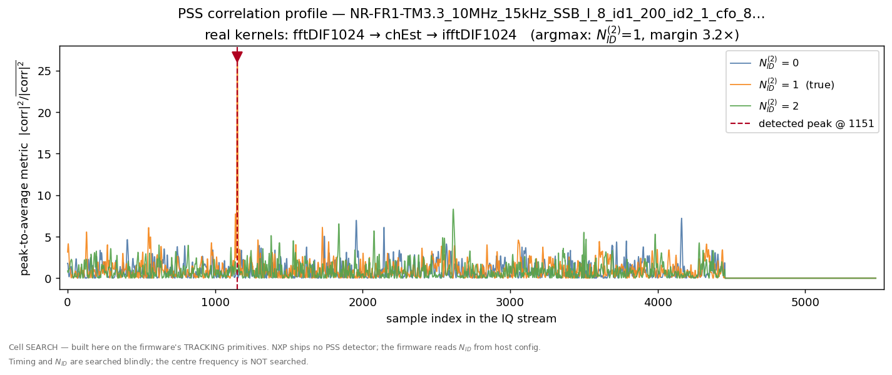
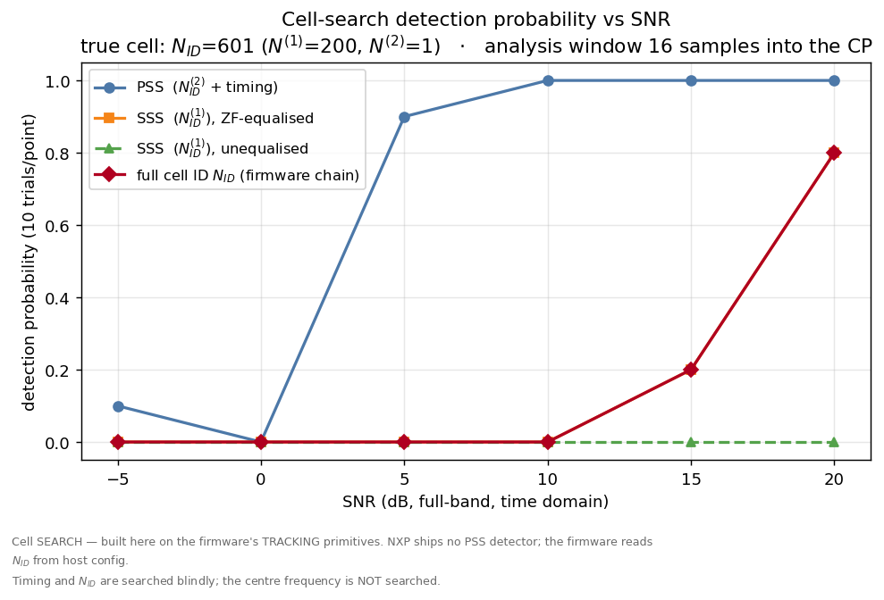
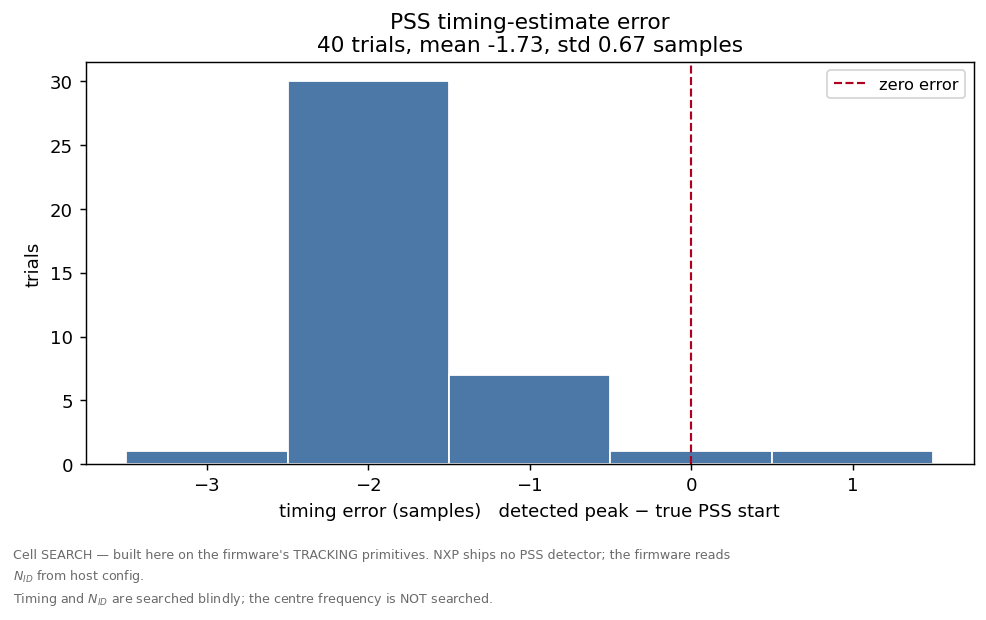
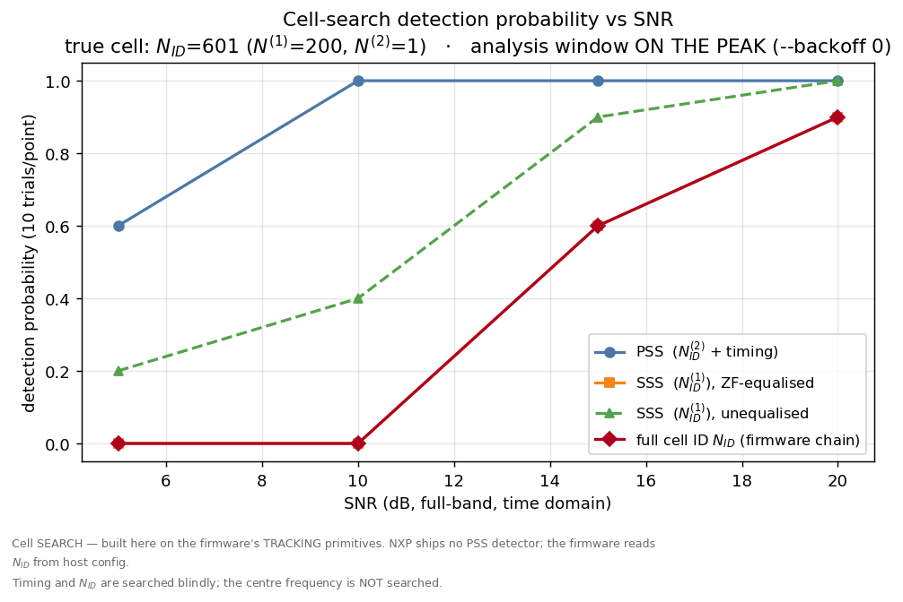

# Tutorial — cell search: finding a 5G cell in a stream of samples

**What you'll learn:** how a 5G receiver finds a cell it knows nothing about — where the
frame starts and which cell it is — and how to run that search on the real LA9310 DFE
kernels, on a simulator, against real NXP test vectors.

You need to know DSP. You do not need to know 5G. No Docker, no Wine, no CodeWarrior, no
hardware — the VSPA instruction-set simulator runs in-process, driven from Python.

Every figure and every number below comes from a live simulator run
(`cosim/scripts/cell_search_cosim.py`). Where something is a Python model rather than a
VSPA kernel, this tutorial says so — §7 is a table of exactly that.

If you have not read [`TUTORIAL.md`](TUTORIAL.md) (the transmit chain), read it first. It
explains `DfeSession`, SM16, and the two memories; this tutorial assumes them.

---

## Setup

```bash
export VSPA_TOOLS=/path/to/cwvspa.../VSPA_Tools          # fsvspacc, to build the kernels
export VSPA_MODEL=/path/to/ccssim2/bin/libvspa2_16au.so  # the ISS itself
./cosim/scripts/fetch_fr1fr2.sh        # NXP's FR1 test vectors — 7 of them carry an SSB
make -C cosim/kernels                  # -> cosim/kernels/build/compute_*.eld
```

---

## 1. The problem

Everything in [`TUTORIAL.md`](TUTORIAL.md) started from a symbol. Someone had already told
us *where the symbol was*.

Now take that away. A receiver that has just been switched on has an ADC producing samples
and knows nothing else:

* it does not know where a symbol starts, so it cannot place an FFT window;
* it does not know which cell is transmitting, so it cannot generate a single reference
  sequence — every pilot, every scrambling code in 5G is keyed to the cell's identity;
* it cannot ask, because transmitting requires knowing all of the above.

This is a chicken-and-egg problem, and 5G breaks it with a beacon that is the same for
everyone: the **SSB** (Synchronisation Signal Block). Two of its four symbols exist purely
to be found by a receiver that knows nothing:

```
   SSB symbol 0 :  PSS   Primary   Synchronisation Signal   ->  timing  +  N_id_2  (3 values)
   SSB symbol 1 :  PBCH  (payload — not our problem here)
   SSB symbol 2 :  SSS   Secondary Synchronisation Signal   ->            N_id_1  (336 values)
   SSB symbol 3 :  PBCH
```

and the cell's identity is the pair, combined arithmetically:

```
   N_id = 3 * N_id_1 + N_id_2          1008 physical cell IDs   (3GPP TS 38.211 §7.4.2.1)
```

**Cell search** is the job of turning a raw IQ stream into `(timing, N_id)`. That is what
this tutorial builds, out of the kernels that ship in `firmware/lib/lib_DFE_Ref_vspa2.elb`.

> **Search is not tracking.** The shipping DFE firmware does cell *tracking*: it reads
> `N_id_1`/`N_id_2` out of a host config word (`GET_CELLTRACK_NID1/NID2` in
> `firmware/src/DFE_func_rx.c`) and refines a cell it was *told* about. Nothing in the
> product ever searches blind. That asymmetry shapes everything below — the library gives
> you superb machinery for confirming a hypothesis and nothing at all for forming one.

## 2. Why PSS is what it is

PSS has to be findable by brute force, by a receiver with no timing and no frequency lock.
That forces its design, and every property is one you would have chosen yourself:

**It is short — 127 subcarriers.** Long enough to be distinctive, short enough to correlate
against cheaply at every candidate offset.

**It is an m-sequence** (a maximal-length LFSR sequence, `x(i+7) = x(i+4) + x(i) mod 2`,
`cosim/vspa_model/nr5g.py`). An m-sequence's periodic autocorrelation is *two-valued*: `N`
at zero lag, and exactly `−1` at every other lag. There is no lag at which it partially
resembles itself. Correlate a stream against it and a true alignment produces a spike that
nothing else can imitate — which is precisely what a blind timing search needs.

**There are exactly three of them**, `N_id_2 ∈ {0,1,2}`, made by cyclically shifting the
same base sequence by `43·N_id_2`. Three is a deliberate compromise: few enough that a
receiver can afford to correlate against *all* of them, but it means one blind correlation
delivers **two** answers at once — the peak's *position* is the timing, and *which of the
three* produced it is `N_id_2`.

So the whole of stage one is: correlate the stream against three known sequences, take the
largest peak. The 5G designers did the hard part.

The remaining 336 identities are carried by SSS (§6), which you can only decode *after* PSS
has told you where the symbol boundary is. Cell search is a two-stage funnel: 3 hypotheses
first, then 336, and never 1008 at once.

## 3. The search is three transforms you already own

Here is the awkward fact, and this tutorial will not paper over it:

> **There is no PSS detector in the DFE library.** A symbol dump of all 27 members of
> `lib_DFE_Ref_vspa2.elb` has **zero** hits for `pss`, `xcorr`, `corr`, `peak` or `search`.
> `firmware/include/ssdet.h` declares a `pssdet_param_T` and names a file
> `pssdet_xcorr_fft_asm.sx` — **in comments only**. Nothing implements them. It is missing
> for the reason in §1: the product tracks, it does not search.

The temptation is to write a correlator in C and call it a day. Don't — a hand-rolled C
correlator would be *your* arithmetic, not the chip's, and it would prove nothing about the
library. Instead, use the cross-correlation theorem:

```
   corr[d] = Σ_n  rx[W+n] · conj(pss[n−d])
           = IDFT( DFT(rx_window) · conj(PSS_spectrum) ) [d]
```

Read that right to left and it is **three transforms, and the DFE library ships all three**:

| step | kernel (real assembly, from `lib_DFE_Ref_vspa2.elb`) | our wrapper |
|---|---|---|
| `DFT(rx_window)` | `fftDIF1024_sc128_hfx_hfx_vspa2` | `cosim/kernels/compute_ssb_fft.c` |
| `· conj(REF)` | **`chEst`** | `cosim/kernels/compute_ssb_corr.c` |
| `IDFT(…)` | `ifftDIF1024_sc128_hfx_hfx_vspa2` | `cosim/kernels/compute_ssb_corr.c` |

The middle one deserves a word, because it looks like a cheat and is not. `chEst` is
documented as a least-squares channel estimator and its header talks about 802.11ac
VHT-LTF. Ignore the prose and read the machine code: it is `set.Smode S0conj…` followed by
`cmad` — an elementwise `x[k] · conj(p[k])`. That *is* the per-subcarrier term of a matched
filter. Using it as one is not repurposing; it is the same arithmetic under a different
name. Feed it a PSS spectrum instead of a pilot and it is a correlator.

Two bonuses fall out. One pass returns the correlation at **all 1024 lags at once**, so
searching over timing costs nothing extra. And a time-domain correlator — 1024 dot products
of 1024 terms — has no kernel behind it either, so this is not merely elegant, it is the
only route that stays on real assembly.

**What the reference is matters.** For the PSS search the reference spectrum is **zero** off
the 127 PSS subcarriers — that is what makes it a matched filter. In the *channel estimation*
chain of §6 the very same `chEst` gets a pilot padded with `1+0j` instead, because there a
zero would blow up the `1/H` that follows. Same kernel, two references, two jobs. Do not copy
one into the other.

## 4. Run it

```bash
LD_LIBRARY_PATH=$PWD/environment/ccssim2/bin \
    python3 cosim/scripts/cell_search_cosim.py
```

The stimulus is a **real NXP FR1 vector**, not a synthetic SSB — one of seven that carry a
labelled SSB, complete with deliberately injected carrier-frequency offset (300–1000 Hz) and
timing offset. The vectors are frequency-domain RE grids, so the script OFDM-modulates one
back into a time-domain IQ stream (1024-point IFFT + 72-sample CP) to get the raw stream a
searcher actually consumes. **That reconstruction is numpy, and it is the *stimulus*, not the
thing under test.** Everything downstream of it is real assembly.

The ground truth is in the *filename* — that is, from outside the simulator entirely:

```
NR-FR1-TM3.3_10MHz_15kHz_SSB_l_8_id1_200_id2_1_cfo_800_toi_80_RE_offset_300_FDD_fd.bin
                                     ^^^^^^^^^^^^^^^^^  ^^^^^^^^ ^^^^^^
                                     the cell           +800 Hz  +80 samples
```

```
  GROUND TRUTH   N_id_1 = 200, N_id_2 = 1  ->  N_id = 3*200+1 = 601
                 PSS symbol body starts at stream sample 1168

--- BLIND SCAN over the whole stream (18 windows, step 256, 1024 lags each) ---
  PSS  N_id_2 = 1   (true 1)   OK
       peak at sample 1151, margin over the other two hypotheses 3.2x
       symbol-grid prediction 1168; residual -17 samples
  SSS  accepted N_id_1 = [200]   (true 200)
  CELL N_id = 601   (true 601)   OK
PASS — cell found in a real NXP burst: N_id = 601, PSS peak @ sample 1151
```



One spike, on one of the three hypotheses, at one sample index. The orange trace
(`N_id_2 = 1`) shoots to ~26 on the peak-to-average axis; nothing else in the stream —
including the two wrong hypotheses, which see the same 5480 samples — gets past ~8. That
ratio is the **3.2× margin** the run reports, and it is the number to watch: it is what
collapses first when the SNR drops (§8).

And a cross-check nobody built in: the peak lands at 1151, **17 samples before** the symbol
grid says the body starts. That is not an error, that is the vector's own injected timing
offset. `toi=80` is quoted at NXP's 61.44 MHz reference rate; this stream runs at
`1024 × 15 kHz = 15.36 MHz`, so it should appear as `−80 × 15.36/61.44 = −20` samples. We
measured −17, with an integer-quantised peak. The detector recovered an impairment that was
written into the filename by a different tool, years ago, at a different sample rate.

---

## 5. Three traps

Each of these produced a *confident, plausible, wrong* answer first. That is the failure mode
worth fearing: none of them looked like a bug.

### 5.1 The lag is cyclic

The correlation a 1024-point window produces is **circular**. Lag `d` and lag `d − 1024` are
the same hypothesis, so a symbol that starts 18 samples *before* window `W` appears at lag
**1006**, not at lag −18. Fold that naively onto the sample axis as `W + 1006` and you have
invented a peak a whole symbol away from the cell — *with exactly the height of the real
one*, because it **is** the real one. The argmax then chooses between the true peak and its
alias by luck.

It chose wrong: the first version of this pipeline reported a confident detection **1463
samples** off.

**The fix is not a bigger threshold, it is a change of bookkeeping.** Make the windows *tile*
the sample axis: window `w` is responsible for candidate symbol starts in `[W_w, W_w + step)`
and is allowed to claim **those lags only**. Every candidate start is then owned by exactly
one window, no lag is ever counted twice, and the alias cannot be constructed. (`scan_windows`
and the `own[]` slices in `pss_search`.)

### 5.2 The beacon is 19 dB *below* the traffic

You would expect the sync signal to be the loudest thing on the air. In these vectors it is
among the quietest. Measured directly on the grid:

```
PSS resource elements   rms   876 LSB     <- the thing we are looking for
in-band data REs        rms  8192 LSB     <- the TM3.3 traffic sharing the band
                             ---------
SSB below the traffic         19.4 dB
```

The correlation buys back `10·log10(127) = 21.0 dB` of processing gain — and that is *all* it
buys. So the true PSS peak clears an ordinary data symbol's correlation floor by a couple of
dB and no more. An argmax over **absolute** `|corr|²` across the stream lands on a data
symbol. Confidently. It did.

**The fix is to stop measuring the wrong quantity.** Normalise each window/hypothesis profile
by its own mean power:

```python
noise  = mag.mean(axis=-1, keepdims=True)     # per (window, hypothesis)
metric = mag / noise                          # dimensionless
```

This is a **CFAR** (constant-false-alarm-rate) detector, and it is what a real searcher uses
anyway — absolute correlation depends on an unknown AGC gain, so only the *peak-to-average*
ratio means anything. A data symbol's lag profile is noise-like, so its max/mean over 1024
lags is only about `ln(1024) ≈ 7`; the PSS symbol's peak is coherent and lands at 26.5. That
is why the y-axis of the figure above is dimensionless, and why the separation is clean.

### 5.3 The cyclic prefix protects you on one side only

This one survived the longest, because the pipeline *passed* on the vector we developed it on
and on two others. It failed on two — and the pattern in the failures is the whole lesson.

The five cells tested at that point split **exactly** by the sign of the timing residual:

| vector | residual of detected peak | SSS result |
|---|---|---|
| `id1_200_id2_1` (`toi=80`) | **−17** (early) | `[200]` ✓ |
| `id1_1_id2_0` (`toi=50`) | **−25** (early) | `[1]` ✓ |
| `id1_335_id2_2` (`toi=50`) | **−25** (early) | `[335]` ✓ |
| `id1_200_id2_0` (`toi=−40`) | **+11** (late) | `[]` ✗ **no detection** |
| `id1_200_id2_2` (`toi=−40`) | **+12** (late) | `[]` ✗ **no detection** |

PSS was perfect in all five — right `N_id_2`, right timing. The SSS stage lost the cell in
exactly the two cases where the analysis window started *after* the symbol body did.

That is not a coincidence, and it is not about noise. **An OFDM cyclic prefix is a one-sided
guard:**

* an **early** window still lies entirely inside the symbol — that is what the CP is *for*.
  It adds a linear phase ramp across the subcarriers, and `chEst` folds that ramp straight
  into `H`, so the ZF weights cancel it exactly. Harmless.
* a **late** window straddles the **next** symbol. That is inter-symbol interference, and
  nothing downstream can undo it.

To confirm the mechanism rather than assert it, hold the detection fixed and slide *only* the
analysis window. `--backoff N` starts the window `N` samples early, so this is one flag
(vector `id1_200_id2_0`, whose peak lands at 1179 — 11 samples late):

```
  backoff   window  residual     SSS(ZF) accepts
       −8     1187      +19      [53, 200]   <- ISI: the true id AND a spurious one. Ambiguous.
        0     1179      +11      []          <- ISI: cell lost          (this was the bug)
        8     1171       +3      [200]  ✓
       16     1163       −5      [200]  ✓     (the default)
       24     1155      −13      [200]  ✓
       32     1147      −21      [200]  ✓
       48     1131      −37      [200]  ✓
       64     1115      −53      [200]  ✓
```

Every window inside the CP recovers the true `N_id_1`. Both windows past the symbol boundary
lose it — and the one furthest past it is *worse than a miss*, because it accepts a
**spurious second cell ID** (53) alongside the true one. A detector that returns two cells is
not conservative, it is wrong.

**The fix is one line**: start the analysis window `CP_BACKOFF = 16` samples *early*, inside
the CP (≈ CP/4 — clear of the boundary, far from the previous symbol, room for delay spread).

```python
pss_start = max(0, det.peak_index - CP_BACKOFF)
```

You can watch it break and un-break — this is the whole bug, in two commands:

```bash
V=NR-FR1-TM3.3_10MHz_15kHz_SSB_l_8_id1_200_id2_2_cfo_800_toi_-40_RE_offset_300_FDD_fd.bin
python3 cosim/scripts/cell_search_cosim.py --vector $V --backoff 0    # FAIL — N_id = -1
python3 cosim/scripts/cell_search_cosim.py --vector $V --backoff 16   # PASS — N_id = 602
```

With that, all seven labelled cells pass (§6). This is not a fudge — placing the FFT window
inside the cyclic prefix is *the reason the cyclic prefix exists*, and every real receiver
does it.

> **The equaliser is what makes the backoff free.** Backing the window off puts a phase ramp
> on every subcarrier. The ZF chain cancels it, because the ramp is common to the PSS and SSS
> symbols and `chEst` absorbs it into `H`. The *unequalised* detector cannot: it correlates
> against a real ±1 sequence, and a ramp of a couple of turns across 127 REs annihilates a
> coherent correlation. Keep that in mind in §8, where the unequalised path otherwise looks
> like the better one.

---

## 6. SSS: 336 hypotheses, and a detector that only answers yes or no

PSS has given us the symbol boundary and `N_id_2`. The SSS symbol sits two symbols later, and
carries `N_id_1 ∈ [0, 336)`. Its sequence is a **Gold code** — the XOR of two different
m-sequences, cyclically shifted by amounts derived from *both* `N_id_1` and `N_id_2`
(38.211 §7.4.2.3), so a valid SSS also confirms the `N_id_2` that PSS proposed.

Before the SSS can be read, the channel has to be taken out of it. That is **gap 12**, and it
is pure library work — the exact chain of `firmware/src/DFE_func_rx.c`, in
`cosim/kernels/compute_ssb_chest.c`:

```c
chEst(pss_in,  pss_csi, pss_ref, 8);        /* LS channel estimate, on PSS   */
csp_chf_rcpv_asm(pss_eqw, pss_csi, 8);      /* equaliser weights = 1/H       */
chp_chf_csp_vmult_asm(sss_eq, sss_in, pss_eqw, 8);   /* equalise the SSS     */
```

Note the structure: the channel is measured on **PSS** and applied to **SSS** — cross-symbol,
not self-equalisation. (`N = 8` is a count of *DMEM lines* of 32 complex elements, not
samples: `256/32 = 8`. Getting that wrong is a silent 32× error.)

Then the detection itself. And here the library is honest about what it is for:

> `sssdet_targeted_hpgemv_rc_v1(px, scratch, seq, **id1**, **id2**, …)` takes `id1` and `id2`
> as **inputs** and returns **0 or 1**. Its disassembled tail is literally
> `cmp g2,g4; jmp.lt(NO_SSS); mvS.z g0,+$1` — *is the metric above your threshold?* It
> returns no peak, no index, no `N_id`. It is a **verifier**, because tracking is all the
> product needs.

A blind search is still reachable **with the real kernel**, by using it as the scoring
function it already is: call it once per hypothesis, **336 times**, and see which it accepts
(`cosim/kernels/compute_sss_det.c`). Every correlation is shipped assembly; the only thing we
add is the loop. It is by far the most expensive thing in this pipeline — the 336-call sweep
with the score bisection below costs 1.54 M simulated phases in one go — and it is honest.

You can even recover a *score* from a kernel that returns one bit. `det(t) == 1 ⟺ metric ≥ t`,
and `t` (`thre_sss`) is an input — so the metric is `sup{ t : det(t) == 1 }`, and a bisection
on `t` recovers it to any precision, without reimplementing a line of the correlation. That
turns the verifier into a ranker:

```
detects the true N_id_1, and only it       accepted id1 = [200]   (true 200)
argmax of the recovered metric             peak = 1.0000 @ id1=200
                                           runner-up = 0.0179 @ id1=53   -> margin 55.8x
```

**The sharpest check available** is not the flag at all — it is that the detector *emits* the
±1 SSS chips of whatever `(id1, id2)` it was asked about, decoded from the D0/D1 bit tables
with `ld.qam`. Those must match 3GPP for **every** hypothesis, and they cannot come out right
if the tables, the packing, or the kernel are wrong:

```
all 336 emitted SSS sequences match 3GPP 38.211 §7.4.2.3     336/336 exact
```

Finally, the two halves combine into the identity the receiver came for:

```
N_id = 3 * N_id_1 + N_id_2 = 3 * 200 + 1 = 601
```

### All seven cells

One vector proves a pipeline runs. Seven prove it works. The NXP set contains seven labelled
SSB vectors, covering seven distinct cells, both numerologies, and injected CFO from −400 to
+1000 Hz — and with the §5.3 fix in place, the search finds **every one**, blind:

| vector | true `N_id_1` / `N_id_2` | PSS peak | SSS accepts | detected `N_id` | |
|---|---|---|---|---|---|
| `10MHz_15kHz … id1_200_id2_0` (`toi=−40`) | 200 / 0 | 1179 | `[200]` | **600** | ✓ |
| `10MHz_15kHz … id1_200_id2_1` (`toi=80`) | 200 / 1 | 1151 | `[200]` | **601** | ✓ |
| `10MHz_15kHz … id1_200_id2_2` (`toi=−40`) | 200 / 2 | 1180 | `[200]` | **602** | ✓ |
| `20MHz_30kHz … id1_0_id2_2` (`toi=50`) | 0 / 2 | 1146 | `[0]` | **2** | ✓ |
| `20MHz_30kHz … id1_1_id2_0` (`toi=50`) | 1 / 0 | 1146 | `[1]` | **3** | ✓ |
| `20MHz_30kHz … id1_335_id2_0` (`toi=70`) | 335 / 0 | 40 | `[335]` | **1005** | ✓ |
| `20MHz_30kHz … id1_335_id2_2` (`toi=50`) | 335 / 2 | 50 | `[335]` | **1007** | ✓ |

**7/7.** Note `N_id_1 = 0` and `N_id_1 = 335` — both ends of the range — and note that the
detector accepts exactly one `N_id_1` in every case. Before the CP backoff, rows 1 and 3 of
this table were outright failures (`accepted N_id_1 = []`). That is what a one-line window
placement is worth.

## 7. What runs on the VSPA, and what does not

This is the table to read sceptically. Everything in the first block is the real, shipped
assembly out of `firmware/lib/lib_DFE_Ref_vspa2.elb`, executing on the instruction-set
simulator.

| stage | kernel | real assembly? |
|---|---|---|
| window FFT of the IQ stream | `fftDIF1024_sc128_hfx_hfx_vspa2` | **yes** |
| matched filter (`· conj(PSS)`) | `chEst` | **yes** |
| back to the lag domain | `ifftDIF1024_sc128_hfx_hfx_vspa2` | **yes** |
| LS channel estimate on PSS | `chEst` | **yes** |
| equaliser weights `1/H` | `csp_chf_rcpv_asm` | **yes** |
| equalise the SSS symbol | `chp_chf_csp_vmult_asm` | **yes** |
| SSS detection, ×336 | `sssdet_targeted_hpgemv_rc_v1` | **yes** |
| SSS reference construction | `sssConvert` | **yes** |
| RSSI / RSRP / RSRQ / SINR | `sss_msmts` | **yes** |
| residual CFO, timing offset | `fineCFO_rc`, `tim_off_est_sp_asm_rc` | **yes** |

And what is **not** on a kernel — stated plainly, because a tutorial that hides a fallback is
a lie:

| step | why it is on the host | is it signal processing? |
|---|---|---|
| OFDM-modulating the vector into an IQ stream | it is the **stimulus**, not the DUT | n/a |
| AWGN, timing shift | stimulus | n/a |
| **bit-reversal between the two transforms** | both FFTs are decimation-in-frequency (natural in, bit-reversed out), so chaining them needs a reindex. On the VCPU that is a 1024-iteration scalar loop, and the ISS costs ~50 µs/phase — it would cost *more than the FFT it serves*. The library's `bitRev_*` kernels are IPPU microcode, and the IPPU only advances when explicitly stepped. **The firmware does do this on the IPPU**; `main_test.c` does it with a software `sw_bitrev()` and says so. | **no** — a pure index permutation, zero arithmetic |
| `\|corr\|²` and the **argmax** | `pow_sum_asm` is a *reduction* (it accumulates `\|x\|²` over a buffer), not the per-lag magnitude profile we need; and the peak search would need `xtrm`, whose returned **index is known to be wrong** when N exceeds the AU batch size | a magnitude and an argmax — bookkeeping |
| the 336-hypothesis **loop** | the kernel is a verifier by design (§6) | no — the correlation inside it is the kernel's |
| PSS/SSS reference **sequences** | the firmware DMAs `pssRef256[]` in from the host; there is no sequence generator in the library either | generated per 38.211, checked 336/336 against the kernel's own output |

**One thing genuinely failed and is worth your time.** There is a second, simpler PSS
approach in this repo — `cosim/kernels/compute_pss_search.c` — which does the `N_id_2`
decision *coherently in the frequency domain* on the real `chEst` kernel. On clean input it
is superb: the right hypothesis wins by a margin of **16129×**. On the real NXP vectors it is
**useless**, and section 4 of the regression proves it rather than quietly dropping it:

```
4. Where the coherent metric stops working (the honest limit)
   with a 40-sample timing offset: scores = [2.767e+09, 3.599e+07, 5.886e+09]
                                   -> argmax = 2   (true = 1)     WRONG
```

A timing offset is a linear phase ramp across subcarriers, and a coherent sum across 127 REs
cannot survive one. The vectors *have* timing offsets — that is the point of them. This is
why the shipping pipeline uses the **time-domain correlation magnitude** of §3, which is
immune to it: `|IDFT(...)|` does not care about the phase of the bin it peaks in.

## 8. How well does it work

> **What is *not* searched, stated plainly.** The detector searches all 1024 timing lags and
> all 3 `N_id_2` hypotheses blindly, and then all 336 `N_id_1` hypotheses. It does **not**
> search the SSB's centre frequency: `re_offset` is parsed from the vector's filename, i.e.
> taken from ground truth. A real receiver sweeps a raster of candidate positions. That is one
> number this co-simulation is given rather than finding, and every result below is conditional
> on it.

`--sweep` measures detection probability against SNR — 10 independent noise realisations per
point, the detector searching all 1024 lags and all 3 hypotheses every time.

```bash
LD_LIBRARY_PATH=$PWD/environment/ccssim2/bin \
    python3 cosim/scripts/cell_search_cosim.py --sweep --trials 10
```

```
   SNR      PSS   SSS(ZF)   SSS(raw)     N_id      timing err (samples)
  -5.0     1/10     0/10       0/10      0/10      mean -1.00  std 0.00
   0.0     0/10     0/10       0/10      0/10           (no PSS lock)
   5.0     9/10     0/10       0/10      0/10      mean -1.67  std 1.05
  10.0    10/10     0/10       0/10      0/10      mean -1.60  std 0.66
  15.0    10/10     2/10       0/10      2/10      mean -1.90  std 0.30
  20.0    10/10     8/10       0/10      8/10      mean -1.80  std 0.40

19,398,584 VSPA phases simulated, 1614 s wall clock
```



**Read the x-axis carefully.** SNR is quoted **full-band, in the time domain**. The PSS
occupies 127 of 624 subcarriers, so its own in-band SNR is **6.9 dB below** the number on the
axis — and, per §5.2, it sits a further 19.4 dB below the traffic sharing the band. "0 dB" on
this plot is a far harder problem than it sounds.

**The two stages have completely different sensitivities, and that is the headline.**

*PSS is strong.* It goes from nothing to 9/10 between 0 and 5 dB and is at 10/10 from 10 dB
up. Timing and `N_id_2` are cheap — exactly as designed in §2, and exactly what a 127-chip
m-sequence with 21 dB of processing gain should buy you.

*The full cell ID is not.* `N_id` needs **20 dB** for 8/10, and it is the **SSS stage** that
costs it — at 10 dB the search knows precisely where the cell is and which of three
`N_id_2` it uses, and still cannot name it. The red curve is the product; the blue curve is
what the product could be if the second stage matched the first.

### Timing accuracy



Across the 40 trials that achieved PSS lock, the peak lands **1.73 samples early on average,
with a standard deviation of 0.67** — and *every single trial* falls in `[−3, +1]`.

That is the number the whole receiver hangs on, and it is the reason §5.3's fix is safe. The
timing estimate is good to about ±2 samples; the analysis window is backed off by 16; the
cyclic prefix is 72 long. The error budget sits comfortably inside the guard on the safe
side, with margin for delay spread — which is precisely how you want an OFDM receiver
dimensioned, rather than by luck.

### Where it breaks down — honestly

**Below 5 dB, the search dies at PSS.** 1/10 at −5 dB, 0/10 at 0 dB. Remember what 0 dB
means here: the PSS's own in-band SNR is −6.9 dB, and it is 19.4 dB under the traffic sharing
its band. The correlation has 21.0 dB of processing gain and that is the entire budget. It
runs out.

**Between 5 and 15 dB you get half an answer** — timing and `N_id_2`, 10/10, but not the cell.
This is a strange and specific failure: the receiver knows exactly where the cell is and
cannot say who it is.

**The limiting stage is the zero-forcing equaliser, and I can show it rather than assert it.**
`csp_chf_rcpv_asm` computes `1/H`, and `H` is estimated from that same 19.4 dB-down PSS. At
low SNR the small-`|H|` bins invert into large noise — the equaliser amplifies exactly what it
is meant to clean. The evidence is a sweep run with the analysis window sitting on the peak
(`--backoff 0`), where the unequalised control is still usable:

```bash
python3 cosim/scripts/cell_search_cosim.py --sweep --backoff 0 --trials 10 \
        --snr-list 5,10,15,20
```

| SNR | SSS via ZF chain | SSS unequalised |
|---|---|---|
| 5 dB | 0/10 | **2/10** |
| 10 dB | 0/10 | **4/10** |
| 15 dB | 6/10 | **9/10** |
| 20 dB | 9/10 | **10/10** |



Same real detector, same symbol, same noise — the *only* difference is whether `rcpv`'s
weights were applied. At 10 dB the equaliser destroys **every** detection the raw path still
makes; at 15 dB it loses one in three. Read horizontally instead: the raw path reaches 9/10
at 15 dB, the ZF chain not until 20 dB. That is the ~5 dB of sensitivity the equaliser
costs.

> **Note the figure above is a different experiment from §8's**, and the filenames now say so.
> They did not always: the figure files had fixed names, so this `--backoff 0` run silently
> overwrote the default sweep's plot — and the tutorial then showed a table reading
> "SSS unequalised: 0/10 at every SNR" with a plot underneath in which that same curve climbs
> to 10/10. `--figure-tag` exists so a comparison run cannot impersonate the main one.

That does **not** mean "switch the equaliser off," and this is the subtlety the table hides.
Once the window is correctly placed inside the CP (§5.3), the unequalised path collapses to
**0/10 at every SNR** — the placement phase ramp destroys its coherent correlation, and it
is the equaliser that removes that ramp. The two configurations are not "with and without a
nicety"; they are two different broken things:

* window on the peak → the unequalised detector works, but the window risks ISI, and on 2 of
  our 7 vectors it *is* ISI and the cell is lost outright;
* window in the CP → ISI is impossible and all 7 vectors pass, but the SSS can now only be
  read through a zero-forcing equaliser that costs ~5 dB of sensitivity.

**The right answer is available and the library does not ship it.** An MMSE reciprocal —
`H*/(|H|² + σ²)` instead of `1/H` — would keep the ramp cancellation *and* stop the noise
amplification, and it would very likely close most of that 5 dB. There is no MMSE reciprocal
in `lib_DFE_Ref_vspa2.elb`. `rcpv` is the only reciprocal there is. So this floor is a
property of the shipped library, and the honest statement is: **with these kernels, blind
cell search needs ~20 dB, and it is the equaliser, not the detector or the correlator, that
sets that number.**

Two caveats in the other direction, so this is not read as worse than it is. This is a
**single-shot** detection on a 5-symbol stimulus: a real searcher accumulates over SSB bursts
that repeat every 20 ms, and non-coherent accumulation over even a handful of bursts is worth
several dB. And the stimulus is deliberately hostile — the SSB is buried under a full-power
TM3.3 traffic model in the same band, which is a far harder scene than an idle carrier.

## 9. The regression

```bash
LD_LIBRARY_PATH=$PWD/environment/ccssim2/bin python3 cosim/tests/test_cell_search.py
```

It checks each kernel against an independent Python model of the same operation, and every
one of the arithmetic kernels is **bit-exact**:

```
1. chEst / rcpv / vmult — the gap-12 chain
  [PASS] chEst(PSS)  h = y*conj(ref)          max|diff| = 0 LSB
  [PASS] chEst(SSS)  h = y*conj(ref)          max|diff| = 0 LSB
  [PASS] rcpv        w = 32768/H              max rel err = 7.63e-06
  [PASS] vmult       eq = (x/32768)*w         max|diff| = 0 (fp16 exact)
  [PASS] ZF equalisation recovers SSS         max|eq - sss| = 0.0005
  [PASS] fineCFO_rc is linear in the PSS->SSS phase   spread = 3.4e-04
  [PASS] tim_off_est is exactly -256 * (timing offset)

2. SSS blind N_id_1 search over all 336 IDs
  [PASS] detects the true N_id_1, and only it              accepted id1 = [200]
  [PASS] argmax of the recovered metric = true N_id_1      margin = 55.8x
  [PASS] all 336 emitted SSS sequences match 3GPP 38.211   336/336 exact
  [PASS] sssConvert = +/-1 on REs 64..190, 1+0j padding    max|diff| = 0

PASS — all checks green
```

Two details in there are worth more than they look.

`vmult` is **fp16-exact** only once the model narrows toward zero rather than to nearest. The
AU truncates toward zero *everywhere* — in the `cfixed16` path (`chEst`: 889.5 → 889,
−641.5 → −641) and in the fp16 narrowing. Model it with numpy's default round-to-nearest and
you disagree with the kernel on ~30 % of samples by 1 ULP. Same rule, both formats — which is
what you would expect of one piece of hardware.

And section 5 of the regression is nothing but **controls**, because of the trap that governs
this whole harness:

> Kernel buffers are `.bss` globals, and **crt0 zeroes `.bss` *after* the image is loaded**.
> `NativeKernelRunner` therefore writes inputs at a breakpoint on `main()`. Write them any
> earlier and they are silently wiped — and a kernel fed zeros still runs, and still returns
> a clean, plausible, **wrong** answer. If a result ever looks suspiciously clean or
> suspiciously zero, this is why.

So a passing number is never enough on its own. Every check is paired with a control proving
the output *tracks* the input — a different cell must move the detection, a different channel
must move the estimate, and a **zeroed D0/D1 table must detect nothing**:

```
  [PASS] different SSS on the wire -> detection moves     accepted id1 = [42] (true 42)
  [PASS] zeroed D0/D1 -> no detection (the trap, made visible)      accepted id1 = []
```

That last line is the `.bss` failure mode, deliberately induced and asserted to be
**detectable**. A test that cannot fail is not a test.

## 10. Commands

```bash
# find the cell in the default NXP burst (real vector, real kernels)
LD_LIBRARY_PATH=$PWD/environment/ccssim2/bin \
    python3 cosim/scripts/cell_search_cosim.py

# any of the seven labelled SSB vectors
LD_LIBRARY_PATH=$PWD/environment/ccssim2/bin \
    python3 cosim/scripts/cell_search_cosim.py \
      --vector NR-FR1-TM3.3_20MHz_30kHz_SSB_l_1_id1_335_id2_2_cfo_300_toi_50_RE_offset_372_FDD_fd.bin

# detection probability vs SNR (regenerates the figures above)
LD_LIBRARY_PATH=$PWD/environment/ccssim2/bin \
    python3 cosim/scripts/cell_search_cosim.py --sweep --trials 10

# one detection at a given SNR; shift the stream and watch the peak follow
LD_LIBRARY_PATH=$PWD/environment/ccssim2/bin \
    python3 cosim/scripts/cell_search_cosim.py --snr 10 --timing-offset 137

# reproduce the late-window ISI bug of §5.3 (--backoff 0 puts the window on the peak)
LD_LIBRARY_PATH=$PWD/environment/ccssim2/bin \
    python3 cosim/scripts/cell_search_cosim.py --backoff 0 \
      --vector NR-FR1-TM3.3_10MHz_15kHz_SSB_l_8_id1_200_id2_2_cfo_800_toi_-40_RE_offset_300_FDD_fd.bin

# the regression
LD_LIBRARY_PATH=$PWD/environment/ccssim2/bin \
    python3 cosim/tests/test_cell_search.py
```

## 11. What to take away

**A kernel you don't have is sometimes three kernels you do.** There is no PSS detector in
the DFE library, and the cross-correlation theorem meant we never needed one — the search
runs on `fftDIF1024 → chEst → ifftDIF1024`, all shipped assembly. Before writing DSP, check
whether the identity you learned in a signals course has already turned it into something on
the shelf.

**Every one of the three bugs in §5 passed a plausibility check.** The aliased peak was a
real peak. The data-symbol argmax was a real maximum. The late window was 11 samples off out
of 1096. None of them looked wrong; all three were caught by an *external* ground truth — a
cell ID written in a filename by another tool, at another sample rate, years ago. Keep an
anchor outside your own simulation.

**And say where the floor is.** This pipeline finds all seven cells in NXP's vectors and
needs ~20 dB to do it reliably under noise — and the thing standing between those two
sentences is a zero-forcing equaliser inverting a channel estimated from a beacon 19 dB below
the traffic. That limitation is in the shipped library, not in the write-up, and the sweep
above is built to *expose* it rather than to pass. A result you cannot state the failure mode
of is not a result yet.
