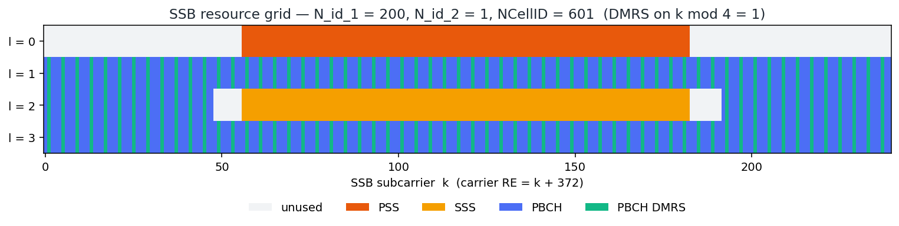
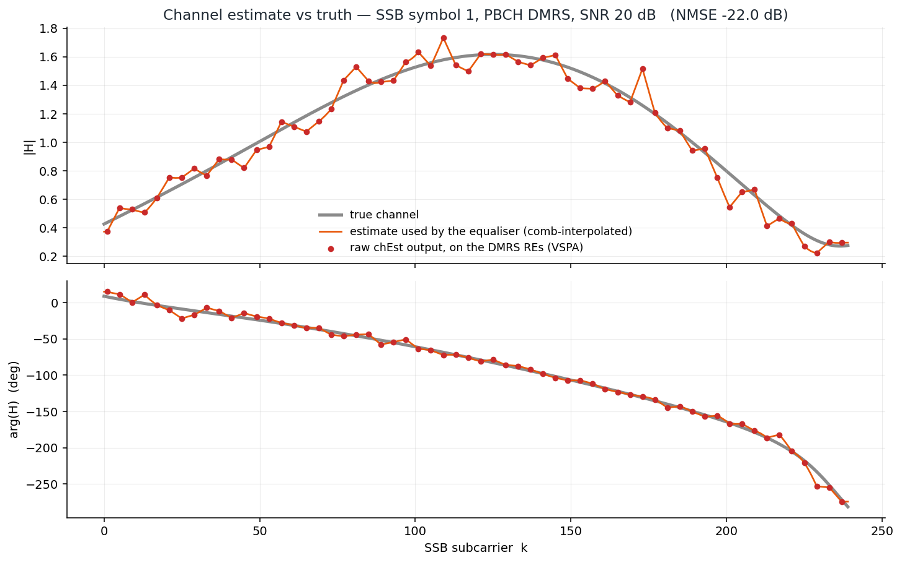
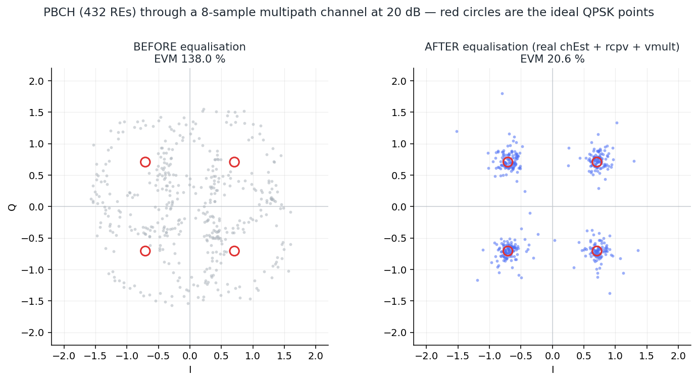
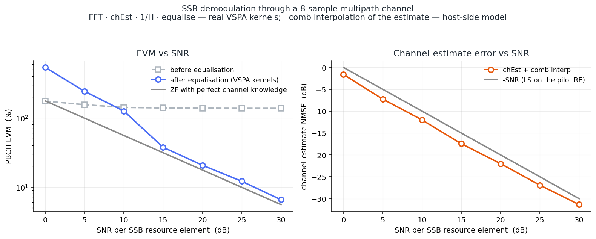

# Tutorial — the SSB: channel estimation and equalisation

**What you'll learn:** what a 5G NR Synchronisation Signal Block is, why a receiver cannot
decode it through a real radio channel without first *estimating* that channel, and how the
LA9310's own DSP kernels do the estimating and the undoing.

You need DSP — FFTs, pilots, complex baseband. You do **not** need 5G. Everything specific to
NR is explained where it first matters.

The companion document [`TUTORIAL.md`](TUTORIAL.md) drives the **transmit** chain and proves it
emits a correct OFDM symbol. This one goes the other way: a signal arrives, mangled by
multipath, and we have to get the bits back out.

Every figure and every number below comes from one live simulator run
(`cosim/scripts/ssb_cosim.py`) — the real firmware kernels, on the in-process VSPA ISS.

---

## 1. The SSB is a beacon

A phone that has just been switched on knows nothing. Not the cell's identity, not its timing,
not its frame boundary, not its bandwidth. It cannot ask — transmitting requires knowing all of
that first. So the network broadcasts a small, self-contained package that can be decoded from
a cold start, by a receiver that knows only the carrier frequency it is tuned to. That package
is the **SSB**, and it carries exactly three things:

| | | what it is for |
|---|---|---|
| **PSS** | Primary Synchronisation Signal | *"a cell is here, and this is where its symbols start"* — a known sequence you correlate against, blind |
| **SSS** | Secondary Synchronisation Signal | *"and this is which cell"* — together with the PSS it pins the 1008 possible cell IDs |
| **PBCH** | Physical Broadcast Channel | the **MIB** — the minimum system information: frame number, subcarrier spacing, where to look for everything else |

The first two are *sync*: find the cell. The third is *data*: read the cell's business card.
And that difference is the whole subject of this tutorial.

Finding the cell is a correlation. It survives a bad channel because a correlator only needs the
peak to be *somewhere* — it does not care that the peak's amplitude and phase are wrong.
**Decoding the PBCH is different.** The MIB is QPSK: the information lives *in the phase*. A
channel that rotates and scales each subcarrier differently destroys it. So the PBCH — and only
the PBCH — forces the receiver to measure the channel and invert it. That is the step no AWGN
simulation ever reaches, and the step this document is about.

## 2. The resource grid

An SSB is **240 subcarriers wide and 4 OFDM symbols long** — a small rectangular tile dropped
onto the carrier. Here is the real one, exactly as the co-simulation builds it:



Read it as a picture of the *air interface*: time runs down (l = 0…3), frequency runs across
(k = 0…239).

* **l = 0** is the PSS, and **l = 2** carries the SSS — both only in the middle 127 subcarriers,
  with guard REs either side.
* **PBCH (blue) fills everything else** — all of l = 1 and l = 3, plus the two side-bands of
  l = 2 that the SSS leaves free.
* Threaded through the PBCH, every fourth RE, is the green **DMRS**.

That green comb is the reason the SSB is decodable at all, so look at it closely. It is not a
guard band and it is not overhead the designers regretted — it is the measurement instrument.

One NR detail worth keeping: the comb's **offset is the cell ID**. DMRS sits on
`k mod 4 == NCellID mod 4`. Here `NCellID = 601`, so the comb sits on `k mod 4 == 1`. Neighbouring
cells therefore put their pilots on *different* REs, and their estimates do not collide. (`NCellID`
comes out of the PSS and SSS — which is precisely why sync has to happen before demodulation, and
not the other way round.)

The carrier underneath is 624 REs on a 1024-point FFT — the same carrier width the LA9310 build
uses for NXP's own FR1 test vectors — with 30 kHz subcarrier spacing, a 72-sample cyclic prefix
and a 30.72 MHz sample rate. The 240-RE SSB is placed at carrier RE 372, and the receiver slices
a 256-point window around it. That 256 is not arbitrary: it is `NR_SSB_NFFT`, the width the firmware's own
cell-tracking buffers are declared at.

## 3. Why the DMRS: the receiver already knows the answer

A radio channel does one thing to an OFDM subcarrier: it multiplies it by a complex number.

```
Y[k]  =  H[k] · X[k]  +  noise
```

`X[k]` is what was sent, `Y[k]` is what arrived, and `H[k]` — one complex gain per subcarrier —
is everything the channel did. Recovering `X` means dividing `H` out. But `H` is unknown, and
so is `X`: one equation, two unknowns, per subcarrier. Unsolvable.

Unless you *already know* `X`. And on the DMRS REs, you do — the DMRS is a pseudo-random QPSK
sequence generated from the cell ID by a rule written into the standard (TS 38.211 §7.4.1.4), so
the moment the SSS has told you `NCellID = 601` you can generate, locally, the exact symbol that
was transmitted on every green RE in that grid. The equation collapses:

```
H_hat[k]  =  Y[k] / X_known[k]          on the DMRS REs
```

That is a **least-squares channel estimate**, and it is the entire idea. Because the DMRS has
unit magnitude, the division is a multiply by the conjugate — which is exactly what the
library's `chEst` kernel computes:

```
h  =  y · conj(pilot)
```

Everything after that is bookkeeping of two kinds:

1. **Interpolation.** The DMRS only occupies every 4th RE, so this gives an estimate on a quarter
   of the band. The channel is smooth in frequency — it has to be, because it is the DFT of a
   short impulse response — so the values in between are *interpolated* from the pilots either
   side. This is the step with no kernel behind it; see §5.
2. **Noise reduction.** `Y/X` divides the noise by the pilot too, so the raw estimate is noisy.
   Averaging over neighbouring pilots trades frequency resolution for noise. Our comb
   interpolation does a little of this for free, which is why the measured channel MSE in §6
   comes out slightly *better* than the raw per-pilot bound.

Here is the real estimate, out of the real kernel, against the channel it was trying to measure:



Grey is the true channel. Red dots are what `chEst` returned on the DMRS REs — the raw
least-squares estimate, one per pilot, noisy. Orange is the interpolated curve the equaliser
actually consumes. At 20 dB SNR the estimate tracks the truth to **−22.0 dB NMSE**.

Note the shape of the grey curve. `|H|` swings from **1.62 down to 0.27** across a band only
240 subcarriers wide, and the phase walks through nearly 300 degrees. That is what "the channel"
actually looks like — and it is what §4 is about.

## 4. What multipath does, and what one tap undoes

The signal reaches the antenna by more than one path — a direct one, and reflections that arrive
a little later. In the time domain that is a convolution with a short impulse response. In the
frequency domain, convolution becomes multiplication, and a *delayed echo* becomes a *linear
phase ramp*; sum a few of them and they interfere — constructively on some subcarriers,
destructively on others. That is the ripple in the grey curve above, and it is why the channel is
called **frequency-selective**. The co-simulation uses a 9-tap Rayleigh channel with an 8-sample
maximum excess delay, which produces **15.5 dB** of selectivity across the SSB: the worst
subcarrier arrives six times weaker than the best.

Each PBCH subcarrier is therefore multiplied by its *own* complex number — a different rotation
and a different scaling for every one of the 432 REs. Plot them all together and the QPSK
constellation is annihilated:



**This figure is the point of the whole document.**

On the left, before equalisation: 432 QPSK symbols that should sit on four points, smeared into a
featureless ring. **EVM 138 %** — the error is larger than the signal. Every point in that cloud
is a correct, undamaged symbol that has simply been rotated and scaled by a number the receiver
has not measured yet. Nothing has been *lost*; it has been *disguised*. No slicer can recover a
single bit.

On the right, after equalisation: four clean clusters on the ideal points, **EVM 20.6 %**. That
is the same data, and the *only* thing that happened in between is a complex division —
one multiply per RE:

```
X_hat[k]  =  Y[k] / H_hat[k]
```

This is **one-tap zero-forcing equalisation**. One tap, because OFDM has already done the hard
part: the cyclic prefix turns the channel's convolution into a per-subcarrier *scalar* multiply,
so undoing it needs a scalar divide and nothing more. No adaptive filter, no matrix inverse, no
training loop. The entire complexity of a multipath channel is defeated by 240 complex divisions,
and *that* is why OFDM is what 5G uses.

Two things the picture will not tell you, and both matter:

**Zero forcing amplifies noise.** Dividing by `H[k]` divides the noise by `H[k]` too. A
subcarrier sitting in a deep fade (`|H| = 0.27` here) gets its noise multiplied by 3.7 on the way
out. ZF perfectly removes the distortion and pays for it in SNR, precisely where the SNR was
already worst. It is the *simplest* equaliser, not the best one — an MMSE equaliser trades a
little residual distortion for not blowing up in the fades.

**On a flat channel it does nothing at all.** Run the same co-simulation with
`--delay-spread 0` and the EVM goes from 9.98 % to **12.14 %** — it gets *worse*. There is no
distortion to undo, so all the equaliser can contribute is the noise in its own estimate. This is
not a defect; it is the control experiment. It proves that the 16.5 dB improvement on the
selective channel really does come from inverting the channel, and not from some incidental
normalisation.

## 5. What runs on the VSPA, and the one thing that does not

Every DSP stage in the signal path is the **real assembly** from
`firmware/lib/lib_DFE_Ref_vspa2.elb`, executed on the instruction-set simulator — the same
routines the shipping firmware calls in `DFE_func_rx.c` — **with exactly one exception**, and
it is named below rather than buried: the comb interpolation of the channel estimate has no
kernel in the library and runs on the host.

| stage | kernel | ELF |
|---|---|---|
| TX: subcarriers → time domain | `ifftDIF1024_sc128_hfx_hfx_vspa2` | `compute_ssb_tx` |
| RX: time domain → subcarriers | `fftDIF1024_sc128_hfx_hfx_vspa2` | `compute_ssb_rx` |
| LS channel estimate on the DMRS | **`chEst`** | `compute_ssb_demod` |
| equaliser weights `1/H` | **`csp_chf_rcpv_asm`** | `compute_ssb_demod` |
| apply the weights | **`chp_chf_csp_vmult_asm`** | `compute_ssb_demod` |

There is **no `zf_equalizer` routine in the library**, and none was invented. Zero forcing is
*composed* from `rcpv` (reciprocal) and `vmult` (vector multiply) — exactly the way
`DFE_func_rx.c` composes it.

Modelled in Python:

* **the channel itself** — multipath taps, CFO, AWGN. That is what a co-simulation is *for*.
* **CP insertion and removal** — on silicon this is DMA address arithmetic, not DSP.
* **the comb interpolation of §3** — and this one is a genuine gap, so it is named.

> **The one modelled DSP step.** `chEst` is elementwise: it returns a channel estimate on the
> DMRS REs and, on the 3 REs in between, hands back the received PBCH data multiplied by the
> pilot buffer's `1+0j` filler. Something has to interpolate across that comb before `rcpv` can
> invert it — and **no kernel in the library does it**. `ssbSmooth` is declared in the NXP
> headers but is *not exported* by `lib_DFE_Ref_vspa2.elb`, and its only call site in
> `DFE_func_rx.c` is commented out. So the interpolation is a piecewise-linear host-side model,
> labelled as such at every point it is used. Real firmware would need that kernel written.
> Everything on either side of it — the LS estimate, the reciprocal, the equalisation — is the
> real thing.

Because the interpolation happens on the host, the demod ELF is called **twice** per SSB: pass 1
reads the raw estimate out of `chEst`; the host interpolates; pass 2 feeds the interpolated
estimate back in for `rcpv` to invert and `vmult` to apply.

And mind the types — they are not uniform, and guessing wrong is silent:

| buffer | type | note |
|---|---|---|
| `rx_sym*`, `h*` | `cfixed16_t` | **sign-magnitude**, not two's complement (see `TUTORIAL.md` §5) |
| `dmrs*`, `eq*` | `cfloat16_t` | a pair of IEEE fp16 |
| `eqw*` | `cfloat32_t` | **two** fp32 words per element — twice the buffer |

The `N` argument to all three kernels is a count of **DMEM lines** (32 complex elements each),
not samples. For a 256-point window, `N = 8`.

## 6. The numbers

SNR here is per SSB resource element, measured *after* the receive FFT — and the script measures
what it actually realised off the empty guard REs beside the SSB, rather than trusting its own
calibration. All 864 PBCH bits, uncoded, through the 15.5 dB-selective channel:

```
   SNR  meas | EVM before EVM after ideal ZF | chan NMSE |  PBCH BER  err ideal BER
  ----------------------------------------------------------------------------------
     0  -0.1 |     174.4%   537.33%  175.96% |     -1.6 dB |  2.88e-01  249  2.10e-01
     5   5.1 |     155.3%   242.17%   98.95% |     -7.2 dB |  1.23e-01  106  1.02e-01
    10  10.1 |     141.5%   125.51%   55.64% |    -12.0 dB |  3.47e-02   30  3.61e-02
    15  15.2 |     139.1%    37.53%   31.29% |    -17.4 dB |  4.63e-03    4  7.65e-03
    20  19.9 |     138.0%    20.63%   17.60% |    -22.0 dB |  1.16e-03    1  4.72e-04
    25  24.7 |     137.6%    12.09%    9.89% |    -26.9 dB |  0.00e+00    0  4.87e-07
    30  30.0 |     137.6%     6.55%    5.56% |    -31.3 dB |  0.00e+00    0  1.05e-15
```



Four things to read out of that.

**EVM before equalisation is flat at ~138 %.** It does not improve with SNR, because it is not
noise — it is the *channel*, and no amount of transmit power fixes it. The grey dashed line in
the left plot is the wall you hit if you skip this whole chapter.

**After equalisation it tracks the theoretical bound.** The solid grey line is what a ZF receiver
that *knew the channel exactly* would achieve. The measured curve sits **1.17×** above it at
20 dB — so the DMRS estimator, comb interpolation and all, costs about **1.4 dB**. That ratio,
not a round number of percent, is the honest bar: it is the only one that separates "our
estimator is good" from "we picked an easy channel".

**Below 10 dB, ZF with an *estimated* channel diverges above the bound** — 537 % at 0 dB, worse
than not equalising at all. That is real ZF behaviour, not a bug: when `H_hat` lands near zero in
a fade, `1/H_hat` explodes. The perfect-CSI bound never suffers this because its `H` is never
wrong. It is reported rather than cropped out of the plot.

**Channel MSE tracks −SNR**, about 1.5 dB better, because interpolating across the comb averages
neighbouring pilots and quietly buys back a little noise.

The PBCH here is **uncoded**. Real PBCH carries rate-1/3 polar coding, which exists precisely to
survive the deep fades that ZF amplifies — so "error-free at 20 dB" would be the wrong bar, and
one you could only clear by quietly choosing a flatter channel. The bar used instead is the BER a
perfect-CSI ZF receiver would *itself* make; the measured BER stays within 1.4× of it everywhere
the comparison has enough errors to mean anything.

## 7. Three ways to get a beautiful, wrong answer

Each of these was hit while building this. All three produce plausible output.

**The `.bss` trap.** `NativeKernelRunner` writes its inputs at a breakpoint on `main()` — *after*
crt0 has zeroed `.bss`. Write them before boot and they are silently wiped; the kernel then
computes on zeros and returns a clean, plausible, entirely fictional answer. A suspiciously tidy
constellation is the classic symptom. So the co-simulation carries three controls that must pass
before any number is believed: a `1+0j` pilot must make `chEst` return the received symbol
bit-for-bit (measured: `max|h_raw − rx| = 0` LSB), negating the input must move the estimate
(1493 LSB), and — for the other half of the chain — **doubling `h_in` must exactly halve the
equalised output** (measured: **2.0000**). That last one is the one that matters: it proves
`rcpv` and `vmult` are really consuming the host's estimate and not a stale buffer.

**`chEst` conjugates the pilot, not the signal.** It computes `h = y · conj(pilot)`. The existing
regression tests could never have discovered this, because they only ever used PSS and SSS
references — which are real ±1, where `conj()` is a no-op. The DMRS is QPSK, so here it matters:
getting it backwards conjugates every channel estimate and still yields a plausible-looking
constellation. It was verified with a genuinely complex pilot.

**The FFT pair's gain is not 1/16.** Nominally the sc128 iFFT/FFT round trip scales by 1/16 =
0.0625. Measured, it is **0.06167** — 1.3 % low, because the fixed-point butterflies truncate
toward zero at every stage. That is a property of the transform, not an error made by the
estimator, so it is calibrated once from a clean run through the real kernels and divided out.
Assuming 1/16 instead would have put a fake **−34 dB floor** under the channel MSE — a floor that
looks exactly like an estimator hitting its limit.

And one bad *test*, which is worth more than the bugs. An early check asserted "equalisation
improves EVM by more than 6 dB". The flat-channel case failed it — correctly, as §4 explains,
since with no distortion to undo the equaliser can only add noise. The check was wrong, not the
code. It is now conditional on the channel actually being selective, and the flat case has been
promoted into the control that proves the selective case's 16.5 dB gain is real.

## 8. Run it

```bash
export VSPA_TOOLS=/path/to/cwvspa.../VSPA_Tools           # fsvspacc, to build the kernels
export LD_LIBRARY_PATH=$PWD/environment/ccssim2/bin       # the ISS itself

make -C cosim/kernels                                     # -> cosim/kernels/build/*.eld
python3 cosim/scripts/ssb_cosim.py                        # the default point: 20 dB, 8-sample channel
```

That is 20 dB through the multipath channel, with the controls, in about 30 s. For the sweep, the
table of §6 and all four figures:

```bash
python3 cosim/scripts/ssb_cosim.py --sweep                # 46 kernel calls on the ISS, ~80 s
```

Useful variations:

```bash
python3 cosim/scripts/ssb_cosim.py --delay-spread 0       # flat channel: the control of §4
python3 cosim/scripts/ssb_cosim.py --delay-spread 40      # a brutal channel, still inside the CP
python3 cosim/scripts/ssb_cosim.py --cfo 300              # add a carrier frequency offset (Hz)
python3 cosim/scripts/ssb_cosim.py --snr 10               # where ZF starts to hurt
```

The delay spread must stay below the cyclic prefix (72 samples). Past that the CP can no longer
absorb the channel and OFDM breaks *by construction* — the script refuses rather than simulate a
link that is broken on purpose.

---

## Where this fits

`TUTORIAL.md` proves the transmitter emits a correct OFDM symbol. This document takes a symbol
that has been through a hostile channel and gets the bits back. Between them sits **cell search**
— finding the PSS and SSS in the first place — which is what supplies the `NCellID` that §3
needs before it can generate a single pilot.

The method, though, is the same one, and it is the same method as in `TUTORIAL.md` §8: **a test is
only worth what it can detect.** A constellation that snaps to four clean points is not evidence —
a kernel reading zeroed `.bss` will hand you one just as readily. Hold the result to a bound that
physics sets and that a bug cannot accidentally satisfy (here: the perfect-CSI ZF EVM), and keep
a control that fails loudly when the plumbing is wrong.
